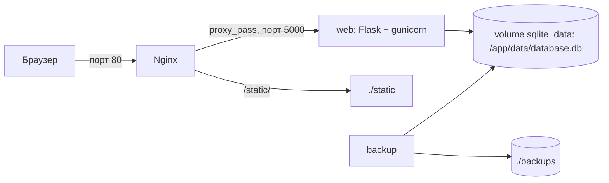

# Кав'ярня з десертами: контейнеризація проєкту (лабораторна робота 08)

**Група:** ІПЗ-21

## Склад команди

| Учасник | Частина |
|---|---|
| Систалюк Артем (teamlead) | зміни в `app.py` (змінні середовища, `/health`, логування), `.env.example`, `.gitignore`, README, схема архітектури |
| *імʼя* | `Dockerfile` і `.dockerignore` |
| *імʼя* | `compose.yaml`, `compose.dev.yaml`, `nginx.conf` |
| *імʼя* | резервні копії бази даних (`scripts/backup.py`), перевірка на чистій системі, розділ Troubleshooting |

## Опис

Вебзастосунок кав'ярні з десертами на Flask з базою даних SQLite (меню, кошик, замовлення, відгуки, адмінка, REST API).
У цій роботі застосунок запаковано в Docker-контейнери: його можна запустити однією командою на будь-якому комп'ютері з Docker,
дані зберігаються у volume, є health check, перезапуск у разі збою, логування, резервні копії та Nginx як reverse proxy.

## Швидкий старт

```bash
git clone <посилання на репозиторій>
cd <назва папки>
cp .env.example .env            # Windows: copy .env.example .env
# у файлі .env замініть SECRET_KEY на випадковий ключ:
#   python -c "import secrets; print(secrets.token_hex(32))"
docker compose up --build
```

Після запуску сайт доступний за адресою `http://localhost`. Зупинка: `docker compose down` (дані зберігаються),
`docker compose down -v` (разом з даними).

Режим розробки (код підключено з комп'ютера, увімкнено налагодження):

```bash
docker compose -f compose.dev.yaml up --build
```

Сайт у режимі розробки: `http://localhost:5000`.

## Змінні середовища

Змінні задаються у файлі `.env` (шаблон: `.env.example`, сам `.env` у Git не потрапляє).

| Змінна | Призначення | Значення за замовчуванням |
|---|---|---|
| `SECRET_KEY` | ключ для сесій (кошик) і flash-повідомлень | `dev-secret-key-change-me` (лише для розробки) |
| `FLASK_DEBUG` | `1` вмикає режим налагодження, у production має бути `0` | вимкнено |
| `LOG_LEVEL` | рівень логування: `DEBUG`, `INFO`, `WARNING`, `ERROR` | `INFO` |
| `DATABASE_PATH` | шлях до файлу бази даних; у контейнері задається в `compose.yaml` як `/app/data/database.db` | `data/database.db` поруч з `app.py` |
| `BACKUP_KEEP` | скільки останніх резервних копій зберігати | `7` |
| `BACKUP_INTERVAL_SECONDS` | як часто робити копію, у секундах | `86400` (раз на добу) |

## Структура репозиторію

```text
app.py                  застосунок Flask (змінні середовища, /health, логування)
models.py, schema.sql   робота з базою даних SQLite
routes/, api/           маршрути сайту та REST API
templates/, static/     шаблони та статичні файли
tests/                  автотести (pytest)
Dockerfile              збірка образу застосунку
.dockerignore           файли, які не потрапляють в образ
compose.yaml            production: застосунок, Nginx, резервні копії
compose.dev.yaml        розробка
nginx.conf              налаштування reverse proxy
scripts/backup.py       резервне копіювання бази даних
.env.example            шаблон змінних середовища
```

## Архітектура



Користувач звертається до Nginx, який передає запити застосунку Flask (gunicorn), а статичні файли віддає напряму.
Застосунок зберігає дані у файлі SQLite, що лежить у named volume, тому дані переживають видалення контейнера.
Окремий сервіс `backup` за розкладом робить копії бази в папку `backups/`.

## Образ (Dockerfile)

TODO (учасник 1): базовий образ, багатоетапна збірка, кешування шарів, користувач без прав адміністратора, розмір образу
(одноетапний і багатоетапний варіанти), пояснення директив.

## Сервіси та volumes. Development і production

TODO (учасник 2): сервіси з `compose.yaml` (web, nginx, backup), volumes, restart policy, логування контейнерів,
чим `compose.dev.yaml` відрізняється від `compose.yaml`, що робить Nginx.

## Збереження даних SQLite

SQLite зберігає всю базу в одному файлі. Шлях до нього береться зі змінної `DATABASE_PATH`, а сам файл лежить
в директорії `/app/data`, яку підключено як named volume `sqlite_data`. Якби файл лежав поруч з `app.py`, він потрапляв би в образ
і кожна нова збірка «скидала» б базу. Таблиці створюються автоматично при запуску (`CREATE TABLE IF NOT EXISTS`), тому на порожньому
volume застосунок сам створює базу й наповнює її початковими даними.

## Health check

Застосунок має endpoint `GET /health`: він повертає `{"status": "healthy", "database": "connected"}` із кодом 200,
якщо застосунок працює й база даних доступна, або код 500 із описом помилки, якщо запит до бази не вдався.
Docker періодично викликає цей endpoint, і за результатом контейнер отримує статус `healthy` або `unhealthy`
(перегляд: `docker compose ps`).

## Логування

Застосунок виводить логи в stdout, тому їх видно командою `docker compose logs -f web`. Рівень задається змінною `LOG_LEVEL`.
`PYTHONUNBUFFERED=1` в образі гарантує, що повідомлення зʼявляються без затримки.

## Резервні копії

TODO (учасник 3): як робиться копія (через `sqlite3` backup API, а не копіювання файлу), де зберігається, скільки копій,
як відновити базу.

## Перевірка на чистій системі та результати

TODO (учасник 3): що перевірено (запуск із чистого клону, збереження даних після `down` і `up`, health check, перезапуск
після збою, backup і відновлення) і результати.

## Troubleshooting

TODO (учасник 3): типові проблеми та рішення (порт зайнятий, немає `.env`, `ModuleNotFoundError`,
сторінка не відкривається, права доступу до `/app/data`).

## Обґрунтування рішень

- **База даних у volume, а не в образі:** дані мають жити окремо від контейнера й образу.
- **Створення бази на рівні модуля:** `init_db()` викликається при імпорті `app.py`, тому база створюється і під gunicorn, де блок `if __name__ == '__main__'` не виконується.
- **Налагодження вимкнене за замовчуванням:** режим `FLASK_DEBUG=1` вмикається лише змінною середовища й лише в `compose.dev.yaml`.
- **`host='0.0.0.0'`:** без цього застосунок у контейнері не приймав би з'єднання ззовні.
- **Секрети у `.env`:** файл не потрапляє в Git, у репозиторії лежить лише `.env.example`.

TODO: решта пунктів (вибір образу, багатоетапна збірка, Nginx, backup) — після завершення відповідних частин.

## Висновки

TODO: 3-5 речень про те, чому навчились і які були складнощі.
