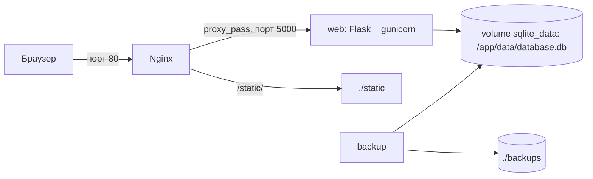

# Кав'ярня з десертами: контейнеризація проєкту (лабораторна робота 08)

**Група:** ІПЗ-21

## Склад команди

| Учасник | Частина |
|---|---|
| Систалюк Артем (teamlead) | зміни в `app.py` (змінні середовища, `/health`, логування), `.env.example`, `.gitignore`, README, схема архітектури |
| Марчук Максим | `Dockerfile` і `.dockerignore` |
| Мельник Віталій | `compose.yaml`, `compose.dev.yaml`, `nginx.conf` |
| Кубський Максим | резервні копії (`scripts/backup.py`), перевірка на чистій системі, Troubleshooting |

## Опис

Вебзастосунок кав'ярні з десертами на Flask з базою даних SQLite (меню, кошик, замовлення, відгуки, адмінка, REST API).
У цій роботі застосунок запаковано в Docker-контейнери: його можна запустити однією командою на будь-якому комп'ютері з Docker,
дані зберігаються у volume, є health check, перезапуск у разі збою, логування, резервні копії та Nginx як reverse proxy.

## Швидкий старт

```bash
git clone <посилання на репозиторій>
cd <назва папки>
cp .env.example .env            # Windows: copy .env.example .env
# у файлі .env замініть SECRET_KEY на випадковий ключ:
#   python -c "import secrets; print(secrets.token_hex(32))"
docker compose up --build
```

Після запуску сайт доступний за адресою `http://localhost`. Зупинка: `docker compose down` (дані зберігаються),
`docker compose down -v` (разом з даними).

Режим розробки (код підключено з комп'ютера, увімкнено налагодження):

```bash
docker compose -f compose.dev.yaml up --build
```

Сайт у режимі розробки: `http://localhost:5000`.

## Змінні середовища

Змінні задаються у файлі `.env` (шаблон: `.env.example`, сам `.env` у Git не потрапляє).

| Змінна | Призначення | Значення за замовчуванням |
|---|---|---|
| `SECRET_KEY` | ключ для сесій (кошик) і flash-повідомлень | `dev-secret-key-change-me` (лише для розробки) |
| `FLASK_DEBUG` | `1` вмикає режим налагодження, у production має бути `0` | вимкнено |
| `LOG_LEVEL` | рівень логування: `DEBUG`, `INFO`, `WARNING`, `ERROR` | `INFO` |
| `DATABASE_PATH` | шлях до файлу бази даних; у контейнері задається в `compose.yaml` як `/app/data/database.db` | `data/database.db` поруч з `app.py` |
| `BACKUP_KEEP` | скільки останніх резервних копій зберігати | `7` |
| `BACKUP_INTERVAL_SECONDS` | як часто робити копію, у секундах | `86400` (раз на добу) |

## Структура репозиторію

```text
app.py                  застосунок Flask (змінні середовища, /health, логування)
models.py, schema.sql   робота з базою даних SQLite
routes/, api/           маршрути сайту та REST API
templates/, static/     шаблони та статичні файли
tests/                  автотести (pytest)
Dockerfile              збірка образу застосунку
.dockerignore           файли, які не потрапляють в образ
compose.yaml            production: застосунок, Nginx, резервні копії
compose.dev.yaml        розробка
nginx.conf              налаштування reverse proxy
scripts/backup.py       резервне копіювання бази даних
.env.example            шаблон змінних середовища
```

## Архітектура



Користувач звертається до Nginx, який передає запити застосунку Flask (gunicorn), а статичні файли віддає напряму.
Застосунок зберігає дані у файлі SQLite, що лежить у named volume, тому дані переживають видалення контейнера.
Окремий сервіс `backup` за розкладом робить копії бази в папку `backups/`.

## Образ (Dockerfile)

Використовується `python:3.12-slim` у двох етапах. На етапі `builder` залежності встановлюються в окреме віртуальне середовище; у фінальний `runtime` копіюється лише це середовище й потрібні файли застосунку. `requirements.txt` копіюється до вихідного коду, тож зміни шаблонів не змушують Docker повторно встановлювати пакети. `--no-cache-dir` не залишає кеш pip в образі.

Фінальний образ запускається від непривілейованого користувача `app` (UID 10001). Каталог `/app/data` створюється з правами цього користувача до монтування volume. `.dockerignore` прибирає Git-історію, локальне середовище, тести, кеші, базу й резервні копії з контексту збірки. Health check виконує Python-запит до `/health`, тому образу не потрібні `curl` або `wget`.

Основні директиви: `FROM` задає базовий образ і етап; `RUN` створює середовище та користувача; `WORKDIR` задає робочий каталог; `COPY` переносить залежності й застосунок; `USER` знижує привілеї процесу; `EXPOSE` документує порт; `HEALTHCHECK` перевіряє стан; `CMD` запускає Gunicorn.

## Сервіси та volumes. Development і production

Production-конфігурація має три сервіси. `web` запускає Flask через Gunicorn і монтує named volume `sqlite_data` у `/app/data`. `nginx` публікує порт 80, передає динамічні запити до `web:5000`, а статичні файли віддає напряму. `backup` запускає скрипт резервування, читає ту саму SQLite-директорію та записує копії у `./backups` на хості. Nginx і backup стартують після того, як health check `web` стане успішним.

Усі production-сервіси мають політику `restart: unless-stopped` та обмеження розміру JSON-логів; перегляд — `docker compose logs -f web` або `docker compose logs -f backup`. У режимі розробки `compose.dev.yaml` запускає Flask з налагодженням на `localhost:5000`, підключає код з робочої теки та використовує окремий `dev_sqlite_data`; Nginx і плановий backup не запускаються.

## Збереження даних SQLite

SQLite зберігає всю базу в одному файлі. Шлях до нього береться зі змінної `DATABASE_PATH`, а сам файл лежить
в директорії `/app/data`, яку підключено як named volume `sqlite_data`. Якби файл лежав поруч з `app.py`, він потрапляв би в образ
і кожна нова збірка «скидала» б базу. Таблиці створюються автоматично при запуску (`CREATE TABLE IF NOT EXISTS`), тому на порожньому
volume застосунок сам створює базу й наповнює її початковими даними.

## Health check

Застосунок має endpoint `GET /health`: він повертає `{"status": "healthy", "database": "connected"}` із кодом 200,
якщо застосунок працює й база даних доступна, або код 500 із описом помилки, якщо запит до бази не вдався.
Docker періодично викликає цей endpoint, і за результатом контейнер отримує статус `healthy` або `unhealthy`
(перегляд: `docker compose ps`).

## Логування

Застосунок виводить логи в stdout, тому їх видно командою `docker compose logs -f web`. Рівень задається змінною `LOG_LEVEL`.
`PYTHONUNBUFFERED=1` в образі гарантує, що повідомлення зʼявляються без затримки.

## Резервні копії

`scripts/backup.py` відкриває вихідну базу SQLite в режимі читання та створює узгоджений знімок через `sqlite3.Connection.backup()`. Це безпечно під час роботи застосунку; звичайне копіювання файлу могло б зафіксувати неповний стан. Спочатку знімок записується у тимчасовий файл, а потім атомарно перейменовується у `backups/database-<UTC timestamp>.sqlite3`. Після кожного знімка залишаються останні `BACKUP_KEEP` копій (за замовчуванням 7). Перший backup робиться одразу після запуску сервісу, наступні — через `BACKUP_INTERVAL_SECONDS` (за замовчуванням доба). Перебіг і помилки відображаються в stdout: `docker compose logs -f backup`.

Щоб відновити конкретну копію, спочатку зупиніть усі процеси, які можуть писати в БД, і підставте ім'я наявного backup замість `<ім'я-файлу>`:

```bash
docker compose stop web backup
docker compose run --rm --no-deps backup python -c "import os,shutil; shutil.copy2('/app/backups/<файл-копії>', '/app/data/database.restore'); os.replace('/app/data/database.restore', '/app/data/database.db')"
docker compose up -d web nginx backup
```

Після запуску перевірте `docker compose ps` і відкрийте сайт. Команда `docker compose down` не видаляє базу чи копії; `docker compose down -v` видаляє named volumes з базами, тому її застосовуйте лише для навмисного скидання даних.

## Перевірка на чистій системі та результати

Для перевірки нового клону створіть `.env` з `.env.example`, зберіть образ і запустіть сервіси командами з розділу «Швидкий старт». Потім перевірте стан `docker compose ps`, endpoint `http://localhost/health`, створіть тестове замовлення та виконайте `docker compose down` і `docker compose up -d`; дані мають залишитися в `sqlite_data`. Видаліть контейнер web командою `docker compose exec web python -c "import os,signal; os.kill(1, signal.SIGKILL)"` і перевірте, що restart policy підніме його знову. Файл у `backups/` відкрийте через `sqlite3` або перевірте `PRAGMA integrity_check`; для перевірки відновлення використайте кроки вище.

Команди для результатів перевірки:

```bash
docker compose ps
docker compose logs --tail=50 web backup
docker compose exec web python -c "import urllib.request; print(urllib.request.urlopen('http://localhost:5000/health').read().decode())"
```

Автоматизовані тести логіки резервування: `pytest tests/test_backup.py -v`. Перевірка конфігурації Compose: `docker compose config` і `docker compose -f compose.dev.yaml config`.

## Troubleshooting

| Проблема | Що перевірити / як виправити |
|---|---|
| Порт 80 зайнятий | Задайте інший порт у `.env`, наприклад `WEB_PORT=8080`, перезапустіть Compose та відкрийте `http://localhost:8080`. Для dev можна задати `DEV_WEB_PORT`. |
| Немає `.env` | Скопіюйте `.env.example` у `.env` (`Copy-Item .env.example .env` у PowerShell) і задайте власний `SECRET_KEY`. |
| `ModuleNotFoundError` | Переконайтеся, що залежність є в `requirements.txt`, потім перезберіть образ: `docker compose build --no-cache web`. Не встановлюйте залежність лише локально на хості. |
| Сторінка не відкривається | Перевірте `docker compose ps` та `docker compose logs -f web nginx`; дочекайтеся `healthy`. Перевірте адресу й порт у `.env`. Застосунок слухає `0.0.0.0:5000` усередині контейнера, а Nginx — порт 80. |
| `/app/data` недоступний для запису | У Dockerfile каталог створюється для UID 10001. Не монтуйте до нього каталог хоста з несумісними правами; для локального dev видаліть лише dev volume, якщо він був створений з іншими правами. Не запускайте контейнер від root як постійне виправлення. |
| Стан `unhealthy` | Перегляньте `docker compose logs web`; перевірте відповідь `/health` та наявність БД у volume. Контейнер з `unhealthy` сам не перезапускається: restart policy реагує на завершення процесу, а не на health status. |
| Backup-контейнер перезапускається | Перевірте `.env`, доступність `/app/data/database.db` і логи `docker compose logs backup`; скрипт записує помилку та повторює спробу на наступному інтервалі. |

## Обґрунтування рішень

- **База даних у volume, а не в образі:** дані мають жити окремо від контейнера й образу.
- **Створення бази на рівні модуля:** `init_db()` викликається при імпорті `app.py`, тому база створюється і під gunicorn, де блок `if __name__ == '__main__'` не виконується.
- **Налагодження вимкнене за замовчуванням:** режим `FLASK_DEBUG=1` вмикається лише змінною середовища й лише в `compose.dev.yaml`.
- **`host='0.0.0.0'`:** без цього застосунок у контейнері не приймав би з'єднання ззовні.
- **Секрети у `.env`:** файл не потрапляє в Git, у репозиторії лежить лише `.env.example`.

Nginx ізолює Flask від публічного порту, обслуговує статичні файли і передає клієнтські IP та схему через proxy-заголовки. Багатоетапна збірка та slim-образ зменшують runtime-вміст, а запуск від окремого користувача обмежує права процесу. Окремий backup-сервіс із SQLite backup API дає узгоджені копії без зупинки сайту.

## Висновки

Під час роботи ми запакували Flask-застосунок у Docker, описали production і development середовища через Compose та винесли SQLite у named volume. Nginx передає HTTP-запити до Gunicorn, а health check і restart policy допомагають стежити за доступністю сервісу. Для захисту даних ми створили окремий backup-сервіс, який використовує SQLite backup API, зберігає останні копії та підтримує відновлення. Перевірки включають запуск із чистого клону, збереження даних, стан контейнерів і сценарії усунення типових помилок.

## Docker Compose, Nginx та середовища dev / prod (Мельник Віталій)

### Файли

| Файл | Призначення |
|---|---|
| `compose.yaml` | production: сервіси `web`, `nginx`, `backup` |
| `compose.dev.yaml` | development: лише `web` з підключеним кодом і режимом налагодження |
| `nginx.conf` | налаштування Nginx як reverse proxy |

### Сервіси та volumes (production, `compose.yaml`)

| Сервіс | Образ | Порт | Призначення |
|---|---|---|---|
| `web` | збирається з `Dockerfile` (етап `runtime`) | `expose: 5000` (назовні не відкритий) | Flask-застосунок; `healthcheck` перевіряє `/health` |
| `nginx` | `nginx:alpine` | `${WEB_PORT:-80}:80` (за замовчуванням 80) | приймає запити з браузера й передає їх у `web`; сам віддає `/static/` |
| `backup` | той самий `Dockerfile` | немає | запускає `scripts/backup.py`, копії зберігає в `./backups` |

- Named volume `sqlite_data` зберігає базу SQLite в `/app/data`, тому дані не зникають після `docker compose down` та перезбирання образу. Видалити їх можна лише командою `docker compose down -v`.
- `nginx.conf` і папка `./static` підключені в Nginx лише для читання (`:ro`).
- `nginx` залежить від `web` з умовою `service_healthy`: Nginx стартує тільки після того, як `web` став `healthy`. Сервіс `backup` теж чекає на `healthy` стан `web`.
- `restart: unless-stopped` автоматично перезапускає сервіси після збою.
- Змінні середовища беруться з `.env` (шаблон `.env.example`), шлях до БД задано як `DATABASE_PATH=/app/data/database.db`.
- Логування: для всіх сервісів драйвер `json-file` з `max-size: 10m` і `max-file: 3`, тому логи не ростуть безмежно. Перегляд: `docker compose logs -f web`.

### Що робить Nginx

Nginx працює як reverse proxy: браузер звертається до порту 80, Nginx передає запити застосунку `http://web:5000` у внутрішній мережі Docker. Зовні порт 5000 закритий. Заголовки `Host`, `X-Real-IP`, `X-Forwarded-For` і `X-Forwarded-Proto` передають застосунку дані про справжнього клієнта й протокол. Запити на `/static/` Nginx обробляє сам (файли з `./static`, кеш на 1 годину, без запису в access log), не навантажуючи Flask. Розмір тіла запиту обмежено `client_max_body_size 2m`.

### Відмінності dev і prod

| | `compose.yaml` (prod) | `compose.dev.yaml` (dev) |
|---|---|---|
| Сервіси | web, nginx, backup | лише web |
| Доступ | `http://localhost` (через Nginx) | `http://localhost:5000` (напряму, змінна `DEV_WEB_PORT`) |
| Код | у образі | bind mount `.:/app`, зміни видно без перезбирання образу |
| Режим налагодження | за `.env` (`FLASK_DEBUG=0`) | `FLASK_DEBUG=1` |
| Volume БД | `sqlite_data` | `dev_sqlite_data` (окремий, не чіпає production) |
| Перезапуск | `unless-stopped` | `"no"` |

### Запуск

```bash
# production (потрібен файл .env, його можна створити з .env.example)
docker compose up --build -d
docker compose ps                 # у колонці STATUS у web має бути healthy
# відкрити http://localhost

# development
docker compose -f compose.dev.yaml up --build
# відкрити http://localhost:5000
```
