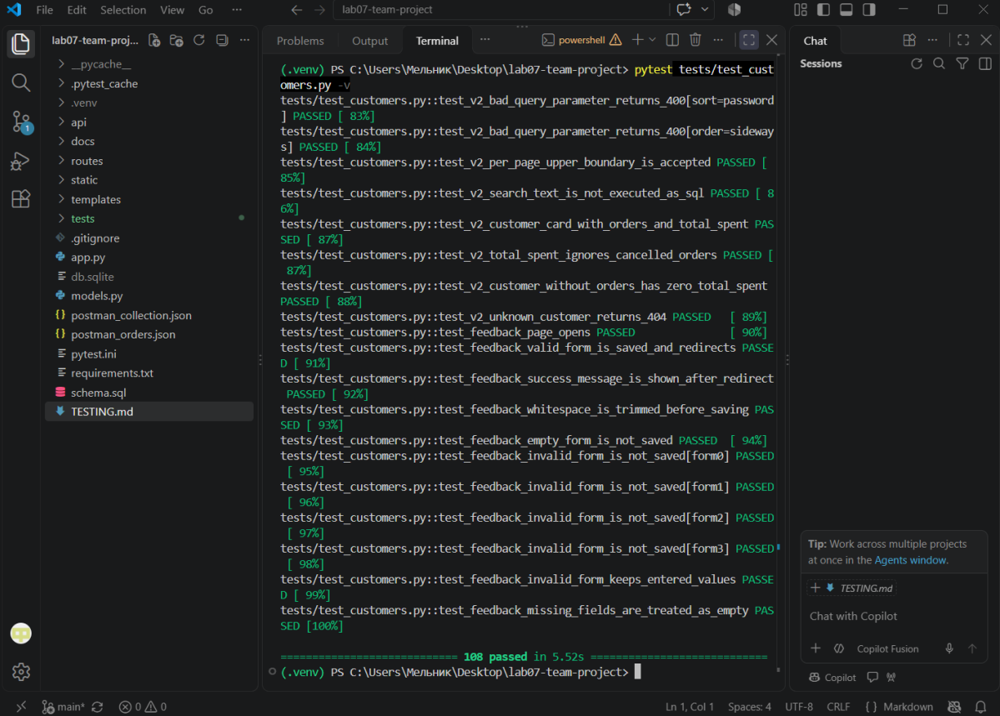

# Тестування застосунку «Кав'ярня з десертами» (лабораторна робота 07)

**Група:** ІПЗ-21

## Склад команди

| Учасник | Частина |
|---|---|
| Систалюк Артем (teamlead) | налаштування pytest (`pytest.ini`, `tests/conftest.py`, `tests/helpers.py`), unit тести `api/utils.py` і `api/errors.py` (`tests/test_utils.py`), integration тести обробки помилок (`tests/test_errors.py`), `TESTING.md`, вимірювання покриття |
| *Марчук Максим* | товари: `tests/test_products.py` |
| *Кубський Максим* | замовлення: `tests/test_orders.py` |
| *Мельник Віталій* | клієнти та відгуки: `tests/test_customers.py` |

## Запуск тестів

```bash
pip install -r requirements.txt
pytest                # усі тести
pytest -v             # з назвою кожного тесту
pytest --cov=app --cov=api --cov=routes --cov=models --cov-report=term-missing   # з покриттям коду
```

## Структура

```text
pytest.ini               налаштування pytest (testpaths, pythonpath)
tests/
├── conftest.py          fixtures: app (тимчасова БД) та client (тестовий клієнт Flask)
├── helpers.py           спільні допоміжні функції (assert_api_error, create_order)
├── test_utils.py        unit тести api/utils.py та api/errors.py
├── test_errors.py       integration тести обробки помилок і ізоляції БД
├── test_products.py     товари
├── test_orders.py       замовлення
├── test_customers.py    клієнти та відгуки
└── test_api.py          тести API лабораторної 5 (написані на unittest, pytest їх теж запускає)
```

## Як працює тестова база даних

Fixture `app` у `tests/conftest.py` перед кожним тестом підставляє в `app.config['DATABASE']` шлях до нового файлу
у тимчасовій директорії (`tmp_path`) і створює таблиці з тестовими даними (`models.init_db()`).
Тому кожен тест починає з однакових даних (2 клієнти, 8 товарів, 2 промокоди), тести не залежать один від одного,
а робоча база `db.sqlite` не змінюється. Це перевіряють `test_tests_use_temporary_database` та два тести `test_isolation_*`.

Усі тести написано за схемою AAA (Arrange - Act - Assert). Граничні значення й набори вхідних даних
перевіряються параметризованими тестами `@pytest.mark.parametrize`.

## Unit тести

Unit тести перевіряють окремі функції без бази даних і вебсервера.

### `tests/test_utils.py`

| Тест | Що перевіряє | Очікуваний результат |
|---|---|---|
| `test_check_string_trims_spaces` | прибирання пробілів по краях | `'  Олена  '` -> `'Олена'`, помилок немає |
| `test_check_string_missing_required_field` | відсутнє обовʼязкове поле (немає ключа або `None`) | повертає `None`, помилка в `errors` |
| `test_check_string_missing_optional_field_is_not_error` | відсутнє необовʼязкове поле | `None`, помилки немає |
| `test_check_string_empty_or_blank_required` | порожній рядок, пробіли, табуляція | помилка |
| `test_check_string_wrong_type` | число, булеве, список, словник замість рядка | помилка «Має бути рядком» |
| `test_check_string_max_length_boundary` | довжина 1, 99, 100, 101 при ліміті 100 | 101 символ відхиляється, решта приймається |
| `test_check_number_accepts_valid` | 0, 0.01, 95, 99.5, 1 000 000 | значення приймаються |
| `test_check_number_rejects_invalid` | від'ємні, рядки, `True`/`False`, NaN, нескінченність, список | помилка |
| `test_check_number_missing_required` / `..._optional_is_not_error` | відсутнє обовʼязкове та необовʼязкове поле | помилка лише для обовʼязкового |
| `test_check_number_custom_minimum_boundary` | мінімум 5: значення 4, 5, 6 | 4 відхиляється, 5 і 6 приймаються |
| `test_normalize_phone` | прибирання пробілів, дужок і дефісів | `'+38 (050) 111-22-33'` -> `'+380501112233'` |
| `test_check_phone_valid` | коректні номери, межі 10 і 13 цифр | номер приймається |
| `test_check_phone_invalid` | 9 цифр, 14 цифр, літери, порожній рядок | помилка |
| `test_check_phone_missing_required` | відсутній телефон | помилка |
| `test_check_email_valid` / `..._is_optional` / `..._invalid` | коректні адреси, відсутній email, адреси без `@`, домену чи з пробілом | необовʼязкове поле; некоректне значення дає помилку |
| `test_raise_if_errors_*` | порожній словник і словник з помилками | нема винятку / `ApiError` 400 з `details` |
| `test_api_error_has_default_message`, `test_api_error_custom_message_and_details` | повідомлення за замовчуванням для кодів 400, 404, 405, 409, 415, 500 і власне повідомлення | повідомлення та `details` збережено |
| `test_get_int_arg_*` | параметр запиту: типове значення, коректне значення, `abc`, 0, -3, 1.5, межі 0/1/100/101 | некоректні дають `ApiError` 400 |
| `test_get_enum_arg`, `test_get_bool_arg_*`, `test_get_float_arg_*` | допустимі значення, значення за замовчуванням, `maybe`, `nan`, `inf` | коректні приймаються, решта дає `ApiError` |
| `test_get_json_body_*` | JSON-обʼєкт, не JSON (415), зламаний JSON (400), масив / рядок / число (400) | словник або `ApiError` |

### Тести товарів, замовлень, клієнтів

#### `tests/test_products.py`

| Тест | Що перевіряє | Очікуваний результат |
|---|---|---|
| `test_validate_product_valid_has_no_errors` | коректні дані | помилок немає |
| `test_validate_product_empty_data_has_errors` | порожні дані | є помилки |
| `test_validate_product_required_field_missing` (параметризований) | відсутнє `name` або `category` | помилка по цьому полю |
| `test_validate_product_blank_string_is_error` | порожній рядок і пробіли | помилка |
| `test_validate_product_length_boundaries` | довжина 1 / 100 / 101 | 101 символ не проходить |
| `test_validate_product_description_length_boundaries` | опис 0 / 1000 / 1001 | 1001 символ не проходить |
| `test_validate_product_price_boundaries` | ціна 0, 0.01, 70, -0.01, -1 | від'ємна ціна не проходить |
| `test_validate_product_price_must_be_number` | ціна рядок, None, список | помилка по `price` |
| `test_validate_product_is_available_must_be_boolean` | `is_available` не булеве | помилка по `is_available` |
| `test_validate_product_partial_*` | часткове оновлення (`partial=True`) | одне поле ок, порожній PATCH помилка |
| `test_product_to_dict_returns_dict_with_fields` | перетворення запису у словник | словник з потрібними полями |
| `test_shop_validate_product_valid_vs_invalid_differ` | `_validate_product(form)` | різний результат для коректної й помилкової форми |

TODO: кожен учасник додає сюди таблицю для свого файлу (`tests/test_orders.py`, `tests/test_customers.py`).

## Integration тести

Integration тести надсилають запити до API через тестовий клієнт Flask і перевіряють код відповіді та тіло JSON.

### `tests/test_errors.py`

| Тест | Запит | Очікуваний код відповіді |
|---|---|---|
| `test_api_index_lists_versions` | `GET /api` | 200, перелік версій v1 і v2 |
| `test_unknown_api_path_returns_json_404` | неіснуючі адреси в `/api/...` | 404, JSON `{"error", "status"}` |
| `test_unknown_site_page_stays_html` | `GET /no-such-page` | 404, відповідь HTML, а не JSON |
| `test_wrong_method_returns_json_405` | `POST /api/v1/customers/1`, `PUT` і `PATCH /api/v1/products`, `DELETE /api/v1/orders` | 405, JSON |
| `test_post_not_json_returns_415` | POST із `text/plain` на товари, клієнтів, замовлення | 415 |
| `test_post_broken_json_returns_400` | POST зі зламаним JSON | 400 |
| `test_post_json_that_is_not_object_returns_400` | POST із масивом, рядком, числом | 400 |
| `test_validation_error_contains_details_per_field` | `POST /api/v1/customers` з `{}` | 400, `details` по полях `name`, `phone` |
| `test_huge_id_returns_400_not_500` | `GET` з id із 31 цифри (6 адрес) | 400, а не 500 |
| `test_huge_page_number_returns_400` | `?page=` із 31 цифри | 400 |
| `test_huge_id_in_delete_returns_400` | `DELETE /api/v1/products/<великий id>` | 400 |
| `test_site_pages_still_return_html` | `/`, `/menu`, `/about`, `/delivery`, `/feedback`, `/cart` | 200, HTML |
| `test_tests_use_temporary_database` | перевірка шляху до БД у тесті | файл `test.sqlite`, а не `db.sqlite` |
| `test_isolation_*` (2 тести) | тест створює клієнта, наступний тест читає список | наступний тест бачить лише початкові дані |

### Тести товарів, замовлень, клієнтів

#### `tests/test_products.py`

| Тест | Запит | Очікуваний код |
|---|---|---|
| `test_v1_list_returns_seeded_products` | GET `/api/v1/products` | 200, 8 товарів |
| `test_v1_get_seeded_product_cheesecake` | GET `/api/v1/products/4` | 200, Чізкейк, 95 |
| `test_v1_filter_by_category` / `..._unknown_category_is_empty` | GET `?category=` | 200 |
| `test_v1_search_by_q` | GET `?q=` | 200 |
| `test_v1_filter_by_available` | GET `?available=true` | 200 |
| `test_v1_post_creates_product` | POST з коректними даними | 201 |
| `test_v1_post_*_returns_400` | POST порожній, ціна рядком, від'ємна ціна, без name | 400 |
| `test_v1_post_name_length_boundary` | POST name 100 / 101 символ | 201 / 400 |
| `test_v1_put_*` | PUT: успіх, невалідні дані, неіснуючий id | 200 / 400 / 404 |
| `test_v1_patch_*` | PATCH: успіх, порожній, невалідний, неіснуючий id | 200 / 400 / 400 / 404 |
| `test_v1_delete_removes_product` | DELETE, потім GET | 200 або 204, потім 404 |
| `test_v1_delete_unknown_returns_404` | DELETE неіснуючого | 404 |
| `test_v1_delete_product_in_order_returns_409` | DELETE товару із замовлення | 409 |
| `test_v2_pagination_*` | GET `/api/v2/products?page=&per_page=` | 200 |
| `test_v2_sort_by_price_ascending` | GET `?sort=price` | 200, за зростанням |
| `test_v2_min_price_*`, `test_v2_max_price_*`, `test_v2_price_range_*` | фільтри за ціною | 200 |
| `test_v2_invalid_params_return_400` (параметризований) | некоректні `page`, `per_page`, `min_price`, `max_price` | 400 |

TODO: кожен учасник додає сюди таблицю для свого файлу.

## Результати

TODO: скріншот `pytest -v` (усі тести passed) зберегти як `docs/img/lab07-pytest.png` і вставити:

```text

```

### Покриття коду

TODO: скріншот `pytest --cov=app --cov=api --cov=routes --cov=models --cov-report=term-missing` зберегти
як `docs/img/lab07-coverage.png` і вставити. Додати одним-двома реченнями, які ділянки не покриті й чому.

## Висновки

TODO: 3-5 речень про те, чому навчились (unit та integration тести, fixtures, тимчасова БД, параметризація, покриття) і які були складнощі.


## Клієнти та відгуки — `tests/test_customers.py` (Мельник Віталій)

Запуск: `pytest tests/test_customers.py -v`. Усі тести написано за схемою AAA. Integration тести використовують fixture `client` з окремою тимчасовою базою (`tmp_path`), тому робочий `db.sqlite` не змінюється.

### Unit тести (без БД і вебсервера)

| Функція | Що перевіряють тести | Очікуваний результат |
|---|---|---|
| `validate_customer` (`api/v1/customers.py`) | коректні дані; телефон `+38 (050) 111-22-33` | імʼя обрізано, телефон `+380501112233` |
| | немає name і phone | `ApiError` 400, у `details` обидва поля |
| | імʼя: порожнє, пробіли, 101 символ, число, список (parametrize) | помилка в `details.name` |
| | межі: імʼя 1 і 100 символів | приймається |
| | телефон: `abc`, 5 / 9 / 14 цифр, літера, число, `True` | помилка в `details.phone` |
| | телефон: 10 і 13 цифр, різні формати | приймається |
| | email: без `@`, `a@b`, `@b.com`, з пробілом; порожній / відсутній | помилка; порожній стає `None` |
| | `partial=True` (PATCH): лише передані поля, порожнє тіло, некоректне значення | перевіряються тільки передані поля |
| `validate_feedback` (`routes/feedback.py`) | коректна форма; порожня форма | `{}`; помилки для name, email, message |
| | email без `@` | помилка email |
| | межі довжини: імʼя 100 / 101, повідомлення 2000 / 2001, email 254 / 255 | на межі приймається, на 1 більше — помилка |
| `parse_quantity` (`routes/cart.py`) | `'3'`, `' 4 '`, `'0'`, `'-5'`, число | ціле значення |
| | `None`, `''`, `'abc'`, `'2.5'` | значення за замовчуванням |

### Integration тести — API клієнтів v1 (`/api/v1/customers`)

| Запит | Очікуваний код |
|---|---|
| GET список | 200, `orders_count` у кожного клієнта |
| GET `/<id>` існуючий / неіснуючий | 200 / 404 (JSON-помилка) |
| POST коректні дані | 201 + заголовок `Location`, клієнт створений |
| POST телефон у іншому форматі | 201, телефон нормалізовано |
| POST дубль телефону (також після нормалізації) | 409, нового клієнта не додано |
| POST порожні / некоректні поля | 400 + `details` |
| POST не JSON / зламаний JSON | 415 / 400 |
| PUT повна заміна; без обовʼязкових полів; неіснуючий; чужий телефон | 200 / 400 / 404 / 409 |
| PATCH одне поле (інші не змінюються); свій телефон; некоректний email; неіснуючий | 200 / 200 / 400 / 404 |
| DELETE клієнта без замовлень | 204 без тіла, далі GET дає 404 |
| DELETE клієнта із замовленнями | 409, клієнт лишається |
| DELETE неіснуючого | 404 |
| POST на `/<id>` (метод не дозволений) | 405 у JSON |
| GET `/<id>/orders` порожній / із замовленням / неіснуючий клієнт | 200 / 200 / 404 |

### Integration тести — API клієнтів v2 (`/api/v2/customers`)

| Запит | Очікуваний результат |
|---|---|
| GET список | 200, формат `{"data": [...], "meta": {...}}` |
| `?per_page=3&page=1` / `page=3` на 7 клієнтах | сторінки 3 + 3 + 1, `pages = 3` |
| `?page=99` | 200, порожній `data` |
| `?q=Олена`, `q=Коваль`, `q=0501112233`, `q=olena@`, `q=немаєтакого` | знайдено / порожній список і `total = 0` |
| `?sort=name&order=asc/desc`, `sort=orders_count` | правильний порядок |
| `page=0`, `-1`, `abc`; `per_page=0`, `101`, `x`; `sort=password`; `order=sideways` | 400 |
| `per_page=100` (межа) | 200 |
| `q=' OR 1=1 --` | 200, порожній список (не SQL-ін'єкція) |
| GET `/<id>` із замовленнями | 200, `orders`, `total_spent` = сума |
| скасоване замовлення | є в `orders`, але не входить у `total_spent` |
| клієнт без замовлень / неіснуючий | `total_spent = 0` / 404 |

### Integration тести — форма відгуку (`/feedback`)

| Запит | Очікуваний результат |
|---|---|
| GET `/feedback` | 200 |
| POST коректна форма | 302 redirect на `/feedback`, запис у таблиці `feedback` |
| після redirect | на сторінці повідомлення «Дякуємо!» |
| пробіли по краях полів | обрізаються перед збереженням |
| POST порожня форма | 200, повідомлення «Вкажіть…», запису в БД немає |
| email без `@`, повідомлення з пробілів, імʼя 101, повідомлення 2001 символів | 200, запису в БД немає |
| помилка в одному полі | введений користувачем текст не втрачається |
| POST без жодного поля | 200 (не 500), запису немає |

**Разом:** 66 тестових функцій (108 запусків з урахуванням parametrize).


